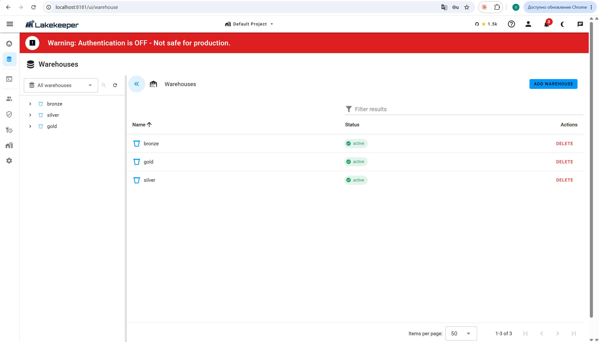
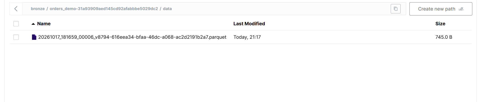
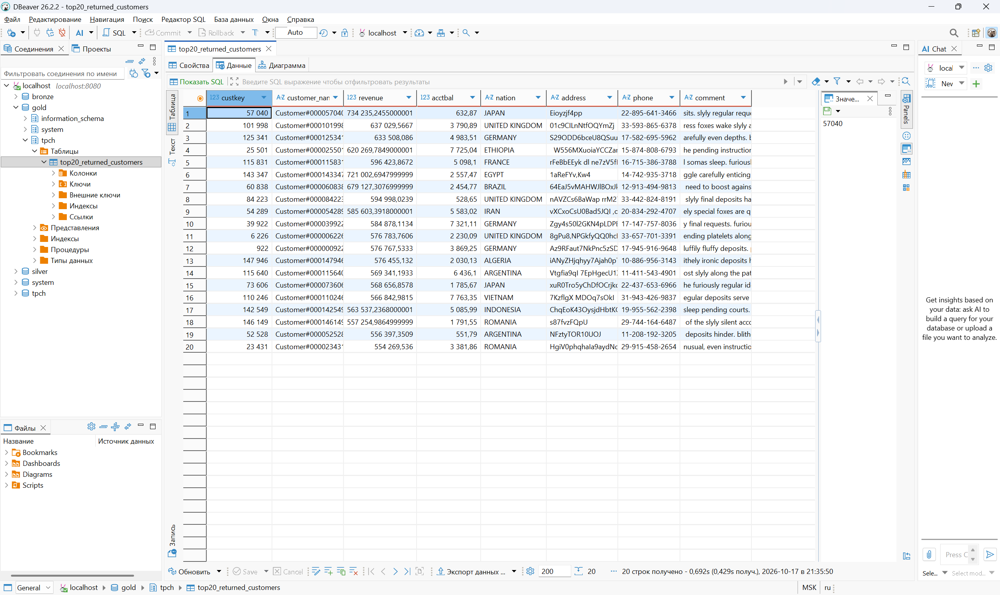
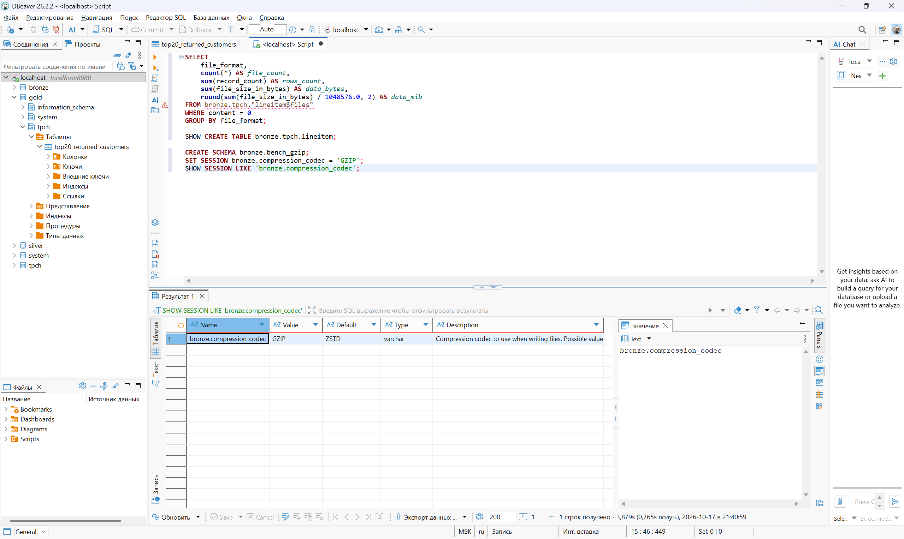
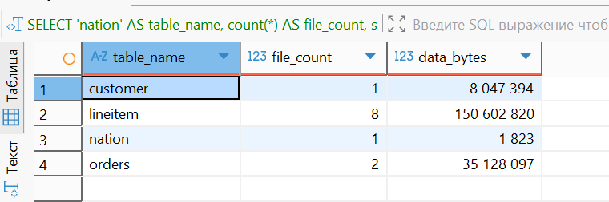
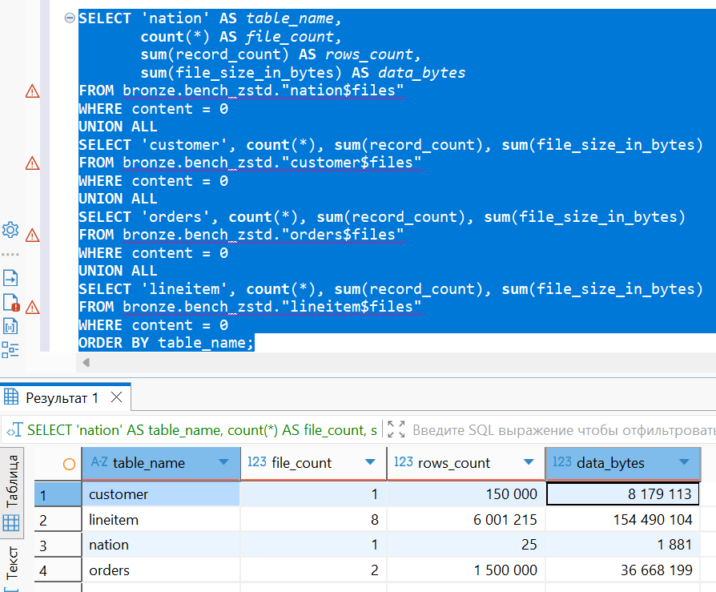
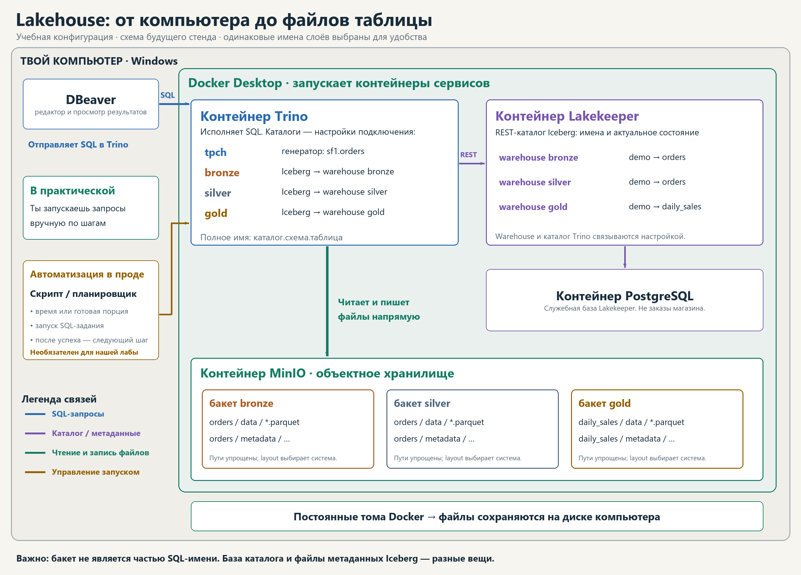

# Отчёт по практической работе №1

## 1. Вариант и масштаб

| Поле | Значение |
|---|---|
| ФИО (как в VK Education) | Щегольков Климентий Тимофеевич |
| Вариант | 2 — Q10 Returned Item Reporting |
| Масштаб | sf1 |
| Дата выполнения / часовой пояс | 17.10.2026 / Europe/Moscow |
| Обоснование масштаба | Выбран sf1: 150 000 клиентов, 1 500 000 заказов и 6 001 215 позиций. Этого достаточно для содержательного сравнения записи и чтения на ноутбуке; больший масштаб увеличил бы время работы и расход ресурсов. sf1 задаёт объём данных, а вариант 2 задаёт запрос Q10. |

## 2. Поднятые сервисы

| Сервис | Версия / роль | Обоснование |
|---|---|---|
| MinIO | RELEASE.2025-04-22T22-12-26Z / S3-хранилище | MinIO предоставляет локальное S3-совместимое хранилище. В нём лежат файлы данных и метаданные Iceberg. Этот выбор позволяет проверить объектное хранение без облачного аккаунта. Использован архивный образ оригинального MinIO с зафиксированным digest. |
| PostgreSQL | 16.12 / служебная БД Lakekeeper | PostgreSQL используется как служебная БД Lakekeeper: хранит записи каталога и настройки. Таблицы TPC-H не загружались в PostgreSQL. Выбор обусловлен поддержкой Lakekeeper и возможностью сохранять каталог в постоянном Docker volume. |
| Lakekeeper | 0.14.0 / Iceberg REST Catalog | Lakekeeper реализует Iceberg REST Catalog: связывает имена таблиц с актуальными метаданными и выдаёт движкам доступ к хранилищу. Отдельный каталог позволяет Trino и DuckDB работать с одними Iceberg-таблицами. |
| Trino | 476 / SQL-движок | Trino выполняет SQL, соединения, фильтрацию, агрегации и запись Iceberg-таблиц. Встроенный коннектор TPC-H генерирует согласованные учебные данные при чтении. Поэтому для работы не нужен отдельный архив с исходным набором. |
| DuckDB в Docker | 1.4.3 / дополнительный SQL-движок, одноразовый контейнер | В качестве дополнительного инструмента выбран DuckDB в Docker. Он компактен и достаточен для локальной аналитики sf1; запуск полноценного Spark-кластера для этой проверки избыточен. DuckDB подключён непосредственно к Lakekeeper и прочитал Bronze без посредничества Trino. Это демонстрирует доступ двух движков к общим таблицам. |
| DBeaver на Windows | 26.2.2 / клиент Trino | Клиент; не заменяет дополнительный инструмент в Docker. |

Стенд локальный: один экземпляр каждого сервиса, аутентификация Lakekeeper отключена, порты опубликованы только на localhost. Отказоустойчивость и промышленная безопасность не демонстрировались. Выключение ноутбука не удалило данные: после восстановления Docker все основные таблицы были повторно прочитаны и проверены.

```powershell
docker compose up postgres minio
# В другой вкладке:
docker compose run --rm lakekeeper migrate
docker compose up lakekeeper trino
# После готовности сервера, в третьей вкладке:
python scripts/bootstrap.py
python scripts/run_pipeline.py
```



*Рисунок 1. Три активных warehouse в Lakekeeper.*

## 3. Разбор запроса

Q10 ищет 20 клиентов с наибольшей суммой возвращённых позиций в заказах, оформленных с 1 октября по 31 декабря 1993 года включительно. Условие относится к дате заказа, а не к дате возврата. Сумма позиции вычисляется как extendedprice × (1 − discount); позиции затем суммируются по клиенту.

| Таблица | Нужные колонки | Операция |
|---|---|---|
| customer | custkey, name, acctbal, nationkey, address, phone, comment | Связь с заказом и страной; группировка и вывод |
| orders | orderkey, custkey, orderdate | Связь с клиентом и позициями; фильтр даты |
| lineitem | orderkey, extendedprice, discount, returnflag | Связь с заказом; фильтр R; расчёт выручки |
| nation | nationkey, name | Связь с клиентом; название страны в выводе |

```sql
SELECT c.custkey, c.name AS customer_name,
 sum(l.extendedprice * (1 - l.discount)) AS revenue,
 c.acctbal, n.name AS nation, c.address, c.phone, c.comment
FROM tpch.sf1.customer c
JOIN tpch.sf1.orders o ON c.custkey = o.custkey
JOIN tpch.sf1.lineitem l ON o.orderkey = l.orderkey
JOIN tpch.sf1.nation n ON c.nationkey = n.nationkey
WHERE o.orderdate >= DATE '1993-10-01'
 AND o.orderdate < DATE '1994-01-01' AND l.returnflag = 'R'
GROUP BY c.custkey, c.name, c.acctbal, n.name, c.address, c.phone, c.comment
ORDER BY revenue DESC LIMIT 20;
```

## 4. Медальон

Основные слои сохранены в Parquet со сжатием ZSTD. Колонночный формат подходит для чтения выбранных столбцов аналитическим запросом и поддерживается обоими движками. Партиционирование не применялось: объём sf1 невелик, а одинаковая организация таблиц упрощает сравнение форматов и кодеков. Это осознанное упрощение локального эксперимента; выигрыш партиционирования здесь отдельно не измерялся.

Размеры рассчитаны как сумма file_size_in_bytes для файлов данных текущего снимка. Метаданные, прежние снимки и другие таблицы бакета не включены. Для пересчёта в МиБ используется 1 048 576 байт. Предварительные измерения и новый контролируемый прогон приведены отдельно: небольшие различия размеров возможны из-за повторной записи файлов.

### Bronze

В Bronze сохранены все исходные строки и столбцы четырёх нужных таблиц. Это сохраняет исходные данные для проверки и повторного расчёта. В сгенерированном TPC-H не требуется искусственно создавать ошибки: сырой слой может уже содержать корректные данные.

| Таблица | Сохранённые столбцы | Строк | Данные, МиБ | Формат | Кодек | Партиционирование | Обоснование |
|---|---|---|---|---|---|---|---|
| `bronze.tpch.nation` | `nationkey`, `name`, `regionkey`, `comment` | 25 | 0,00 | Parquet | ZSTD | нет | В Bronze сохранены все исходные строки и столбцы четырёх нужных таблиц. Это сохраняет исходные данные для проверки и повторного расчёта. В сгенерированном TPC-H не требуется искусственно создавать ошибки: сырой слой может уже содержать корректные данные. |
| `bronze.tpch.customer` | `custkey`, `name`, `address`, `nationkey`, `phone`, `acctbal`, `mktsegment`, `comment` | 150 000 | 7,80 | Parquet | ZSTD | нет | В Bronze сохранены все исходные строки и столбцы четырёх нужных таблиц. Это сохраняет исходные данные для проверки и повторного расчёта. В сгенерированном TPC-H не требуется искусственно создавать ошибки: сырой слой может уже содержать корректные данные. |
| `bronze.tpch.orders` | `orderkey`, `custkey`, `orderstatus`, `totalprice`, `orderdate`, `orderpriority`, `clerk`, `shippriority`, `comment` | 1 500 000 | 34,95 | Parquet | ZSTD | нет | В Bronze сохранены все исходные строки и столбцы четырёх нужных таблиц. Это сохраняет исходные данные для проверки и повторного расчёта. В сгенерированном TPC-H не требуется искусственно создавать ошибки: сырой слой может уже содержать корректные данные. |
| `bronze.tpch.lineitem` | `orderkey`, `partkey`, `suppkey`, `linenumber`, `quantity`, `extendedprice`, `discount`, `tax`, `returnflag`, `linestatus`, `shipdate`, `commitdate`, `receiptdate`, `shipinstruct`, `shipmode`, `comment` | 6 001 215 | 147,23 | Parquet | ZSTD | нет | В Bronze сохранены все исходные строки и столбцы четырёх нужных таблиц. Это сохраняет исходные данные для проверки и повторного расчёта. В сгенерированном TPC-H не требуется искусственно создавать ошибки: сырой слой может уже содержать корректные данные. |

```sql
CREATE TABLE bronze.tpch.nation
WITH (format = 'PARQUET') AS
SELECT * FROM tpch.sf1.nation;
```



*Рисунок 2. Один Parquet-файл пробной таблицы orders_demo с пятью строками, 745 байт; это не размер основной lineitem.*

### Silver

В Silver соединены клиенты, страны, заказы и позиции, отобраны нужный квартал и признак возврата R, вычислена сумма позиции после скидки. Каждая из 114 705 строк остаётся отдельной позицией заказа; агрегации по клиенту ещё нет.

| Таблица | Сохранённые столбцы | Строк | Данные, МиБ | Формат | Кодек | Партиционирование | Обоснование |
|---|---|---|---|---|---|---|---|
| `silver.tpch.returned_order_lines` | `custkey`, `customer_name`, `acctbal`, `nation`, `address`, `phone`, `comment`, `orderkey`, `orderdate`, `linenumber`, `extendedprice`, `discount`, `line_revenue`, `source_name` | 114 705 | 4,38 | Parquet | ZSTD | нет | В Silver соединены клиенты, страны, заказы и позиции, отобраны нужный квартал и признак возврата R, вычислена сумма позиции после скидки. Каждая из 114 705 строк остаётся отдельной позицией заказа; агрегации по клиенту ещё нет. |

### Gold

В Gold позиции сгруппированы по клиентам и рассчитана суммарная выручка; оставлены 20 максимальных результатов. Это готовая витрина для отчёта. При чтении явно применяется ORDER BY revenue DESC: порядок хранения строк не гарантирован.

| Таблица | Сохранённые столбцы | Строк | Данные, МиБ | Формат | Кодек | Партиционирование | Обоснование |
|---|---|---|---|---|---|---|---|
| `gold.tpch.top20_returned_customers` | `custkey`, `customer_name`, `revenue`, `acctbal`, `nation`, `address`, `phone`, `comment` | 20 | 0,00 | Parquet | ZSTD | нет | В Gold позиции сгруппированы по клиентам и рассчитана суммарная выручка; оставлены 20 максимальных результатов. Это готовая витрина для отчёта. При чтении явно применяется ORDER BY revenue DESC: порядок хранения строк не гарантирован. |

```sql
SELECT custkey, customer_name, nation, revenue
FROM gold.tpch.top20_returned_customers
ORDER BY revenue DESC;
```



*Рисунок 3. Витрина Gold в DBeaver.*

### Проверка результата

| Проверка | Результат |
|---|---|
| Строк Silver | 114 705 |
| Строк Gold | 20 |
| Состав клиентов и все остальные поля Q10 | Совпадают с независимым расчётом из tpch.sf1 |
| Допуск сравнения revenue | 0,000001 |
| Проверки прогревов и всех 15 измерений | Все результаты совпали |
| Независимый движок DuckDB | Совпадают все 20 строк и все поля с тем же допуском |

| Клиент | Страна | Выручка |
|---|---|---|
| 57040 | JAPAN | 734 235,2455 |
| 143347 | EGYPT | 721 002,6948 |
| 60838 | BRAZIL | 679 127,3077 |
| 101998 | UNITED KINGDOM | 637 029,5667 |
| 125341 | GERMANY | 633 508,0860 |
| 25501 | ETHIOPIA | 620 269,7849 |
| 115831 | FRANCE | 596 423,8672 |
| 84223 | UNITED KINGDOM | 594 998,0239 |
| 54289 | IRAN | 585 603,3918 |
| 39922 | GERMANY | 584 878,1134 |
| 6226 | UNITED KINGDOM | 576 783,7606 |
| 922 | GERMANY | 576 767,5333 |
| 147946 | ALGERIA | 576 455,1320 |
| 115640 | ARGENTINA | 569 341,1933 |
| 73606 | JAPAN | 568 656,8578 |
| 110246 | VIETNAM | 566 842,9815 |
| 142549 | INDONESIA | 563 537,2368 |
| 146149 | ROMANIA | 557 254,9865 |
| 52528 | ARGENTINA | 556 397,3509 |
| 23431 | ROMANIA | 554 269,5360 |

## 5. Тесты производительности

Для контролируемого прогона созданы три новых набора Bronze: Parquet/GZIP, Parquet/ZSTD и ORC/ZSTD. Каждый содержит одинаковые четыре таблицы, скопированные из bronze.tpch. Настройка кодека передавалась в сессии конкретного запроса записи. Фактическое сжатие и число строк проверены чтением метаданных всех файлов Parquet/ORC; настройка сессии не использовалась как единственное доказательство.

Измерялся полный Q10 непосредственно над каждым набором Bronze. Для каждого варианта выполнен один прогрев, затем пять измерений с чередованием прямого и обратного порядка вариантов. Основная метрика — elapsedTimeMillis из ответа сервера Trino, включая планирование и завершение запроса. Клиентское время сохранено отдельно. Кэши ОС не сбрасывались: это локальный эксперимент с прогретым чтением, а не тест холодного диска. Время CTAS измерено одним проходом и включает чтение источника, запись и фиксацию метаданных; оно не является чистым временем сжатия.

| Параметр | Значение |
|---|---|
| Trino | 476, 1 узел |
| CPU | AMD Ryzen AI 7 350 w/ Radeon 860M |
| Ресурсы Docker | 16 логических CPU, 7 858 216 960 байт RAM |
| Оперативная память хоста | 16 233 902 080 байт |
| Метрика времени запроса | stats.elapsedTimeMillis, сервер Trino |
| Число прогревов / измерений | 1 / 5 на вариант |
| Кэши | Не сбрасывались |

| Вариант Bronze | Данные, байт | Данные, МиБ | Медиана Q10, с | Мин.–макс., с | Сумма CTAS 4 таблиц, с |
|---|---|---|---|---|---|
| parquet_gzip | 193 844 050 | 184,86 | 0,866 | 0,784–1,896 | 22,748 |
| parquet_zstd | 199 368 032 | 190,13 | 0,864 | 0,690–1,933 | 12,664 |
| orc_zstd | 203 179 883 | 193,77 | 0,933 | 0,823–2,195 | 18,152 |

| Таблица / вариант | Строк | Файлов | Данные, байт | Время CTAS, с |
|---|---|---|---|---|
| bronze.final_parquet_gzip.nation | 25 | 1 | 1 815 | 1,434 |
| bronze.final_parquet_gzip.customer | 150 000 | 1 | 8 047 089 | 1,939 |
| bronze.final_parquet_gzip.orders | 1 500 000 | 2 | 35 128 006 | 5,640 |
| bronze.final_parquet_gzip.lineitem | 6 001 215 | 8 | 150 667 140 | 13,735 |
| bronze.final_parquet_zstd.nation | 25 | 1 | 1 878 | 0,575 |
| bronze.final_parquet_zstd.customer | 150 000 | 1 | 8 179 479 | 0,778 |
| bronze.final_parquet_zstd.orders | 1 500 000 | 2 | 36 671 618 | 2,385 |
| bronze.final_parquet_zstd.lineitem | 6 001 215 | 8 | 154 515 057 | 8,926 |
| bronze.final_orc_zstd.nation | 25 | 1 | 1 799 | 0,968 |
| bronze.final_orc_zstd.customer | 150 000 | 1 | 7 506 683 | 1,025 |
| bronze.final_orc_zstd.orders | 1 500 000 | 2 | 34 341 200 | 2,478 |
| bronze.final_orc_zstd.lineitem | 6 001 215 | 8 | 161 330 201 | 13,681 |

В контролируемом прогоне медианы Q10 для Parquet/GZIP и Parquet/ZSTD составили 0,866 и 0,864 с: разница 2 мс мала по сравнению с разбросом, поэтому уверенного победителя по чтению нет. GZIP занял меньше места. ORC/ZSTD в этом прогоне не дал выигрыша по размеру или медиане Q10. Вывод относится к данному набору, настройкам и ноутбуку; он не означает, что один формат или кодек всегда лучше.

### Предварительные измерения

| Кодек | Общий размер, байт | Общий размер, МиБ |
|---|---|---|
| GZIP | 193 780 134 | 184,80 |
| ZSTD | 199 339 297 | 190,10 |



*Рисунок 4. Настройка сессии: Value = GZIP, Default = ZSTD.*



*Рисунок 5. Первоначальные размеры четырёх GZIP-таблиц.*



*Рисунок 6. Первоначальные размеры и количества строк четырёх ZSTD-таблиц.*

Запись lineitem: [GZIP](evidence/screenshots/07-gzip-write-lineitem.png), [ZSTD](evidence/screenshots/08-zstd-write-lineitem.png).

## 6. Осмысление и дополнительные инструменты

### 6.1. Эволюция схемы Silver

В существующую Silver-таблицу добавлен столбец source_system VARCHAR, затем переименован в source_name. Число строк осталось 114 705, новое поле у существующих строк равно NULL. Список и размеры файлов данных до и после совпали: изменение схемы выполнено без перезаписи Parquet.

```sql
ALTER TABLE silver.tpch.returned_order_lines ADD COLUMN source_system VARCHAR;
ALTER TABLE silver.tpch.returned_order_lines RENAME COLUMN source_system TO source_name;
SELECT count(*) AS total_rows, count(source_name) AS populated_source
FROM silver.tpch.returned_order_lines;
```

| Показатель | До | После |
|---|---|---|
| Строк | 114705 | 114705 |
| Столбцов | 13 | 14 |
| Файлов данных | 1 | 1 |
| Размер файлов, байт | 4588922 | 4588922 |
| Непустых source_name | Столбец отсутствовал | 0 |

### 6.2. Time travel и фактическое восстановление

В отдельной учебной таблице silver.tpch.recovery_demo сохранены пять заказов. После удаления одного осталось четыре. Запрос FOR VERSION AS OF прочитал исходные пять строк из сохранённого снимка; затем rollback_to_snapshot восстановил текущее состояние до пяти строк. Проверено точное совпадение всех восстановленных строк с исходными. Основная витрина Gold не изменялась.

```sql
DELETE FROM silver.tpch.recovery_demo WHERE orderkey = 48710;
SELECT * FROM silver.tpch.recovery_demo FOR VERSION AS OF 7386718738304298092;
ALTER TABLE silver.tpch.recovery_demo EXECUTE rollback_to_snapshot(7386718738304298092);
```

| Состояние | Строк |
|---|---|
| До удаления | 5 |
| После удаления | 4 |
| Чтение старого snapshot | 5 |
| После rollback | 5 |

ID исходного снимка: `7386718738304298092`. Точное совпадение восстановленных строк: **true**. .

### 6.3. Дополнительный инструмент в Docker

В качестве дополнительного инструмента выбран DuckDB в Docker. Он компактен и достаточен для локальной аналитики sf1; запуск полноценного Spark-кластера для этой проверки избыточен. DuckDB подключён непосредственно к Lakekeeper и прочитал Bronze без посредничества Trino. Это демонстрирует доступ двух движков к общим таблицам.

```powershell
docker compose --profile tools run --rm duckdb
```

```sql
ATTACH 'bronze' AS bronze_lake (
  TYPE iceberg, ENDPOINT 'http://lakekeeper:8181/catalog',
  AUTHORIZATION_TYPE 'none'
);
SELECT count(*) FROM bronze_lake.tpch.lineitem;
```

| Таблица Bronze | Строк, DuckDB |
|---|---|
| nation | 25 |
| customer | 150 000 |
| orders | 1 500 000 |
| lineitem | 6 001 215 |

### 6.4. Зачем lakehouse

MinIO предоставляет локальное S3-совместимое хранилище. В нём лежат файлы данных и метаданные Iceberg. Этот выбор позволяет проверить объектное хранение без облачного аккаунта. Использован архивный образ оригинального MinIO с зафиксированным digest. Lakekeeper реализует Iceberg REST Catalog: связывает имена таблиц с актуальными метаданными и выдаёт движкам доступ к хранилищу. Отдельный каталог позволяет Trino и DuckDB работать с одними Iceberg-таблицами. В качестве дополнительного инструмента выбран DuckDB в Docker. Он компактен и достаточен для локальной аналитики sf1; запуск полноценного Spark-кластера для этой проверки избыточен. DuckDB подключён непосредственно к Lakekeeper и прочитал Bronze без посредничества Trino. Это демонстрирует доступ двух движков к общим таблицам.

## 7. Выводы

В локальном lakehouse выполнен полный путь Bronze → Silver → Gold и проверен результат Q10. Эксперимент показал, что меньший размер файлов сам по себе не гарантирует более быстрый запрос: GZIP и ZSTD дали близкие медианы чтения. Изменение схемы сохранило файлы данных, а time travel и rollback позволили прочитать и восстановить прежнее состояние. Второй движок DuckDB прочитал те же Iceberg-таблицы и получил совпадающий результат.

## 8. Как я понял, как это работает

Я понял lakehouse как систему, в которой хранение данных, каталог таблиц и выполнение запросов разделены. Docker запускает сервисы в отдельных контейнерах. В DBeaver я пишу SQL и смотрю результат, а сам запрос выполняет Trino.

В этой работе исходные данные генерирует коннектор TPC-H. Когда я выполняю CREATE TABLE AS SELECT, Trino сохраняет результат в MinIO. Parquet — формат файлов с данными. Iceberg описывает, из каких файлов состоит таблица, её схему и снимки состояния. Lakekeeper помогает движку найти актуальные метаданные, а PostgreSQL служит базой самого каталога.

Bronze сохраняет исходные данные. В Silver я соединяю таблицы и подготавливаю нужные строки, а в Gold получаю итог для анализа — в моём варианте 20 клиентов. Эти слои создаются нашими запросами: названия bronze, silver и gold сами ничего не обрабатывают. DuckDB смог прочитать те же Iceberg-таблицы другим движком, без копирования данных из MinIO.

На полной учебной схеме ниже используются условные примеры имён demo.orders и daily_sales. В выполненной работе схема называется tpch, таблица Silver — returned_order_lines, а Gold — top20_returned_customers.


